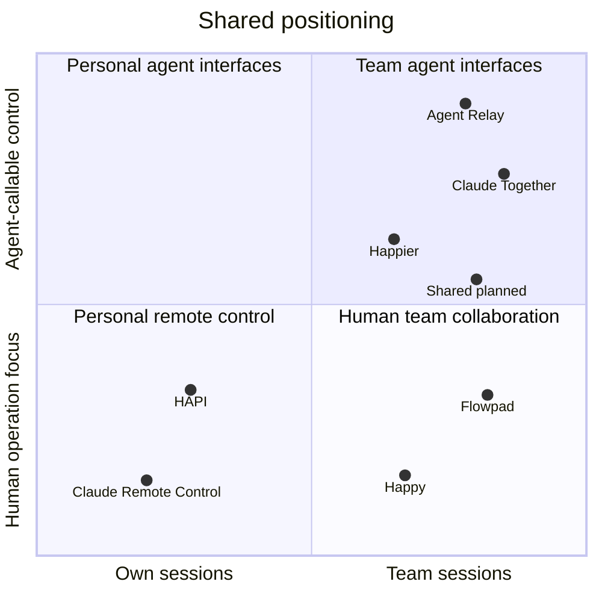

# Competitive landscape

Research date: October 9, 2026.

This comparison uses official product pages, documentation, and public repositories. It is not an installation-based performance or security evaluation. Documentation may describe experimental features or development branches rather than a stable release. An unverified capability is not an absent capability.

## Feature matrix

**O** documented · **X** outside the supported product scope · **?** not verified · **Planned** Shared's intended capability, not implemented.

| Product | Claude and Codex | Teammate participation or messaging | Agent-callable CLI or MCP control | Per-collaborator execution approval delegation | Side questions isolated from the main session |
|---|:---:|:---:|:---:|:---:|:---:|
| Shared | Planned | Planned | Planned | Planned | Planned |
| [Happier](https://github.com/happier-dev/happier) | O | O | O | [O](https://docs.happier.dev/accounts/session-sharing) | ? |
| [Flowpad](https://flowpad.ai/) | O | O | ? | ? | ? |
| [Agent Relay](https://github.com/AgentWorkforce/relay) | O | O | O | ? | ? |
| [Claude Together](https://github.com/wybe-labs/claude-together) | ? | O | O | ? | ? |
| [Happy](https://github.com/slopus/happy) | O | O | ? | ? | ? |
| [HAPI](https://github.com/tiann/hapi) | O | ? | ? | ? | ? |
| [Claude Remote Control](https://code.claude.com/docs/en/remote-control) | X | ? | ? | ? | ? |

Agent-callable control means an interface for querying or sending messages to sessions, not merely a CLI that installs or launches the product. Approval delegation means granting a particular collaborator approval authority, not simply approving one's own agent from another device.

The matrix distinguishes conversation isolation from filesystem isolation. Generic session forks or subagents do not establish that a product offers Shared's proposed restricted side-question workflow.

## Positioning map

The following is a qualitative map of documented workflows, not a quantitative ranking. Coordinates only arrange labels within categories; they are not measured scores. Products may span more than one category. Shared's position is a target.

| Positioning category | Products |
|---|---|
| Team workflows with agent-callable interfaces | Agent Relay, Claude Together, Happier; Shared's target. |
| Human team collaboration | Flowpad and current Happy Harness. |
| Personal remote control emphasis | HAPI and Claude Remote Control. |

Happier also provides human collaboration. Happy supports subagent delegation, but an external agent-callable team-session interface was not verified. HAPI supports multiple clients on certain shared executions; that alone does not establish collaborator-specific team permissions.

## Product findings and official links

### Happier

- Landing page: [happier.dev](https://happier.dev/).
- Sources: [repository](https://github.com/happier-dev/happier), [session sharing](https://docs.happier.dev/accounts/session-sharing), [CLI](https://docs.happier.dev/apps/cli).

Supports multiple providers, session sharing, CLI and MCP control, and approval delegation. Direct sharing has view, edit, and manage levels; approval authority is a separate per-person setting. Friends, required for direct sharing, is experimental and disabled by default according to the sharing documentation.

This is the closest broad comparison. Sharing, permissions, and a CLI are not sufficient differentiation on their own.

### Flowpad

- Landing page: [flowpad.ai](https://flowpad.ai/).
- Source: [repository and CLI documentation](https://github.com/langware-labs/flowpad).

The product page explicitly offers inviting teammates or external advisors into Claude Code and Codex CLI sessions, with shared work context. The repository documents macOS distribution and server-management commands. Detailed execution policies and isolated side questions were not verified.

The repository calls the project open source while its license section displays an all-rights-reserved notice. Do not assume reusable licensing without further review.

### Agent Relay

- Landing page: [agentrelay.com](https://agentrelay.com/).
- Sources: [repository](https://github.com/AgentWorkforce/relay), [introduction](https://agentrelay.com/docs/introduction).

Provides agent messaging across machines and team-session context search. It overlaps with Shared's agent-to-agent query direction and may also be an integration candidate. This comparison refers specifically to AgentWorkforce/relay, not other similarly named projects.

### Claude Together

- Official project page: [GitHub](https://github.com/wybe-labs/claude-together). No separate landing page was identified.

Connects Claude sessions on different machines and accounts through MCP, hooks, and encrypted peer connections. Project registration is opt-in; receivers control whether a room can interrupt a running session. General Codex support and per-command collaborator execution grants were not verified.

### Happy

- Landing page: [happy.engineering](https://happy.engineering/).
- Source: [repository](https://github.com/slopus/happy).

The original CLI emphasizes continuing Claude Code or Codex sessions from other devices. The current Happy Harness also documents inviting colleagues into a session and allowing either participant to steer it. Treat it as a team-collaboration competitor, not only a personal remote-control tool.

### HAPI

- Landing page: [hapi.run](https://hapi.run/).
- Sources: [repository](https://github.com/tiann/hapi), [Codex shared executions](https://hapi.run/docs/guide/codex-shared-sessions).

Provides remote control and approvals for local coding agents. Supported Codex versions can share an app-server between native terminal and remote clients. Its documented process ownership and lifecycle are useful implementation references. Fine-grained collaborator grants and isolated side questions were not verified.

### Claude Remote Control

- Product landing page: [Claude Code](https://claude.com/product/claude-code).
- Feature documentation: [Remote Control](https://code.claude.com/docs/en/remote-control).

An official way to continue one's local Claude session from web or mobile while execution stays on the local machine. It is a Claude-specific feature, not a dual-provider product. Cross-person session permissions and an agent query interface were not verified in the reviewed documentation.

## Shared's differentiation hypotheses

Shared's strongest proposed experience is: **ask a teammate's agent without disrupting their main task, and turn an answer into work only within the owner's policy.**

Validate these together:

- Side questions with explicitly restricted context and no writes to the source workspace.
- Visible context revisions so old answers are not mistaken for current project state.
- Deterministic, collaborator-scoped command rules.
- The same policy and request lifecycle across the macOS app and agent CLI.
- A small, understandable installation and approval experience.

These are hypotheses, not claims that competitors lack these features. In particular, the side-question column still needs hands-on investigation.

## Next comparison experiment

Run the same two-person workflow in Happier, Flowpad, and Agent Relay: share a session, ask about an implementation decision, query from another agent, submit a test request, approve it, and revoke access.

Compare main-session disruption, permission granularity, existing-session compatibility, setup friction, and host resource use. If an existing product sufficiently solves the workflow, evaluate an extension before committing to a separate app.
